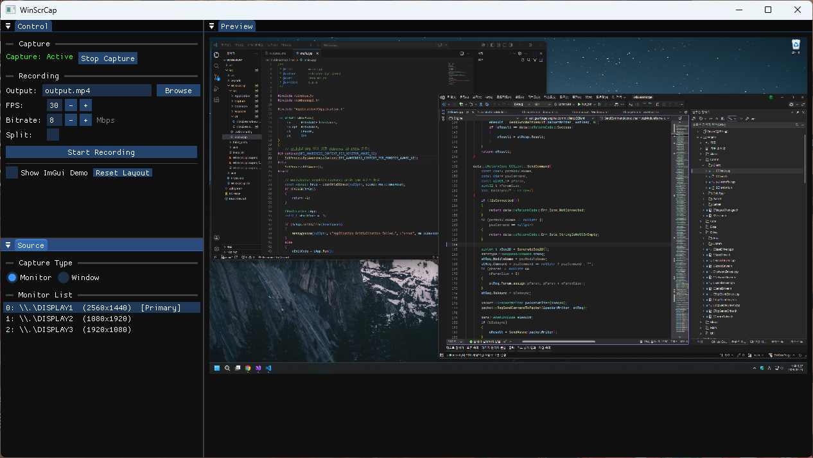

# WinScrCap



A GPU-accelerated Windows screen recorder built with C++20, DirectX 11, and FFmpeg.  
Captures monitors or individual windows and encodes to MP4 (H.264) with hardware acceleration.

> **Built with AI assistance** — developed using [Visual Studio Code](https://code.visualstudio.com/) + [GitHub Copilot](https://github.com/features/copilot) + MSVC (Visual Studio 2026).

---

## Features

- **Dual capture sources** — full monitor via DXGI Desktop Duplication, or specific window via Windows Graphics Capture API
- **Remote capture** — connect to a remote PC running `WinScrCapAgent.exe` over TCP and record its screen from the local machine
- **GPU zero-copy pipeline** — captured `ID3D11Texture2D` frames go directly to the hardware encoder without touching the CPU
- **Hardware encoding with automatic fallback**
  - NVENC (NVIDIA) → AMF (AMD) → QuickSync (Intel) → Windows Media Foundation H.264 (software fallback)
- **Real-time preview** — live ImGui preview panel via `ID3D11ShaderResourceView`
- **Split recording** — automatically splits output files at a configured interval (e.g. every hour), named by timestamp (`ABC_20260722_2000.mp4`, `ABC_20260722_2100.mp4`, …)
- **Configurable encoding** — FPS, CRF / bitrate, output path, encoder selection
- **Minimal resource usage** — separate threads for capture, encoding, and UI

---

## Tech Stack

| Layer | Technology |
|---|---|
| Language | C++20, MSVC |
| UI | [Dear ImGui](https://github.com/ocornut/imgui) + DirectX 11 backend |
| Monitor capture | DXGI Desktop Duplication (`IDXGIOutputDuplication`) |
| Window capture | Windows Graphics Capture API (WinRT COM) |
| Remote capture | Custom TCP binary protocol + FFmpeg H.264 encode/decode |
| Encoding / Muxing | [FFmpeg](https://ffmpeg.org/) LGPL build (H.264, MP4) |
| Hardware encoding | NVENC / AMF / QuickSync / h264_mf fallback |
| Authentication | SHA-256 challenge-response (Windows CNG `bcrypt.lib`) |
| Minimum Windows | Windows 10 1803+ |

---

## Architecture

### GPU Zero-Copy Pipeline

```
DXGI Duplication ──► ID3D11Texture2D (VRAM) ──► D3D11VA Context ──► NVENC / AMF / QSV
                                                                          │
                                                              (fallback)  ▼
                                                         Staging Buffer ──► CPU ──► h264_mf
```

### Remote Capture Pipeline

```
[Remote PC]  WinScrCapAgent.exe
               DXGI Duplication → Staging → NV12 → FFmpeg H.264 encode
                                                           │  TCP (custom binary protocol)
[Local PC]   WinScrCap.exe                                ▼
               CNetworkCapture ← FFmpeg H.264 decode ← recv
                      │  CPU upload
                      ▼
               ID3D11Texture2D → CCaptureManager → CVideoEncoder → MP4
```

> GPU zero-copy is not available for remote frames — network transit requires a CPU→D3D11 upload on the receiving side.

### Threading Model

| Thread | Responsibility |
|---|---|
| Main thread | DX11 rendering + ImGui UI |
| Capture thread | Frame acquisition (high priority) |
| Encode thread | FFmpeg encoding + MP4 muxing |

### Project Structure

```
WinScrCap/
├── WinScrCap.sln
├── WinScrCap/
│   ├── src/
│   │   ├── main.cpp
│   │   ├── Application/
│   │   │   └── CApplication.h/.cpp      ← DX11 device + main loop
│   │   ├── Capture/
│   │   │   ├── ICapture.h               ← Pure virtual interface
│   │   │   ├── CScreenCapture.h/.cpp    ← DXGI Desktop Duplication
│   │   │   ├── CWindowCapture.h/.cpp    ← Windows Graphics Capture API
│   │   │   ├── CNetworkCapture.h/.cpp   ← TCP client + H.264 decode
│   │   │   └── CCaptureManager.h/.cpp   ← Thread + frame queue + FPS control
│   │   ├── Encoder/
│   │   │   └── CVideoEncoder.h/.cpp     ← FFmpeg HW/SW encoder + MP4 muxer
│   │   ├── UI/
│   │   │   └── CMainWindow.h/.cpp       ← ImGui layout
│   │   └── Common/
│   │       └── Types.h                  ← SFrameData, SRemoteTarget, enums
│   └── third_party/
│       ├── imgui/                        ← ImGui source (included directly)
│       └── ffmpeg/                       ← Pre-built LGPL binaries
└── WinScrCapAgent/
    └── src/
        ├── main.cpp                      ← WinMain, tray icon, message loop
        ├── Agent/
        │   ├── CAgentCapture.h/.cpp      ← DXGI capture + CPU staging
        │   ├── CAgentEncoder.h/.cpp      ← FFmpeg H.264 encoder (low-latency)
        │   └── CAgentServer.h/.cpp       ← TCP server + auth + send loop
        ├── UI/
        │   └── CAgentWindow.h/.cpp       ← ImGui status window + settings modal
        └── Common/
            └── AgentConfig.h/.cpp        ← SAgentConfig + INI file I/O
```

---

## Building

### Prerequisites

- Visual Studio 2026 (MSVC v145, C++20)
- Windows SDK 10.0.19041.0+
- FFmpeg LGPL pre-built binaries already included under `third_party/ffmpeg/`

### Steps

1. Clone the repository
   ```
   git clone https://github.com/your-username/WinScrCap.git
   ```
2. Open `src/WinScrCap.sln` in Visual Studio 2026
3. Select the **x64 | Debug** or **x64 | Release** configuration
4. Build (`Ctrl+Shift+B`)
5. Copy the FFmpeg DLLs from `third_party/ffmpeg/bin/` next to the built executable (or add the path to `PATH`)

---

## Usage

1. Launch `WinScrCap.exe`
2. Select a capture source — **Monitor**, **Window**, or **Remote**
   - For **Remote**: enter the agent host/port/password and click **Connect**
3. Configure encoding settings: FPS, quality (CRF / bitrate), output file path
4. Optionally enable **Split Recording** and set the interval (minutes)
5. Click **Record** — a live preview appears while recording
6. Click **Stop** to finalize and write the MP4 file

### Running the Agent (for Remote Capture)

1. Copy `WinScrCapAgent.exe` (and FFmpeg DLLs) to the remote PC
2. Launch it — a status window and tray icon appear
3. Open **Settings** to configure port, password, FPS, CRF, and monitor index
4. The agent listens for an incoming connection from WinScrCap

The agent returns to the listening state when WinScrCap disconnects, even if the
captured desktop is idle. Unresponsive peers and stalled socket transfers time out
after 10 seconds; agent shutdown cancels socket waits without waiting for that timeout.

Agent connection regression tests (MSVC and Windows SDK required; no GPU or FFmpeg required):

```powershell
powershell -NoProfile -ExecutionPolicy Bypass -File .\src\WinScrCapAgent\tests\RunTests.ps1
```

These exercise the real TCP worker with deterministic capture/encoder substitutes:
idle disconnect/reset and reconnect, fragmented Stop/Pong packets, heartbeat timeout,
stalled transmission timeout, and shutdown during authentication or a blocked send.

---

## Remote Capture Protocol

- **Transport**: TCP (Winsock2, IPv4/IPv6), one client at a time
- **Auth**: SHA-256 challenge-response — server sends a random 16-byte nonce, client replies with `SHA256(password + nonce)`; empty password skips auth
- **Frame packet**: `[4B magic "FRAM"] [4B payload size] [8B timestamp µs] [H.264 NAL units]`
- **Control packet**: `[4B magic "CTRL"] [1B type: 0x01=Ping 0x02=Pong 0x03=Stop]`
- **Security note**: no TLS — intended for LAN or VPN use only

---

## License

This project is licensed under the [MIT License](LICENSE).

FFmpeg is used under the **LGPL v2.1** license. Only LGPL-compatible components are linked; no GPL codecs are included. See [FFmpeg License](https://ffmpeg.org/legal.html) for details.

Dear ImGui is licensed under the MIT License.
